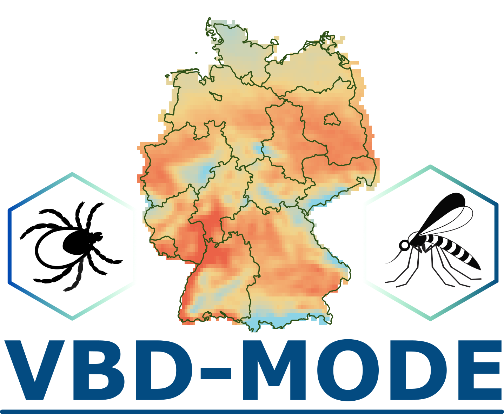
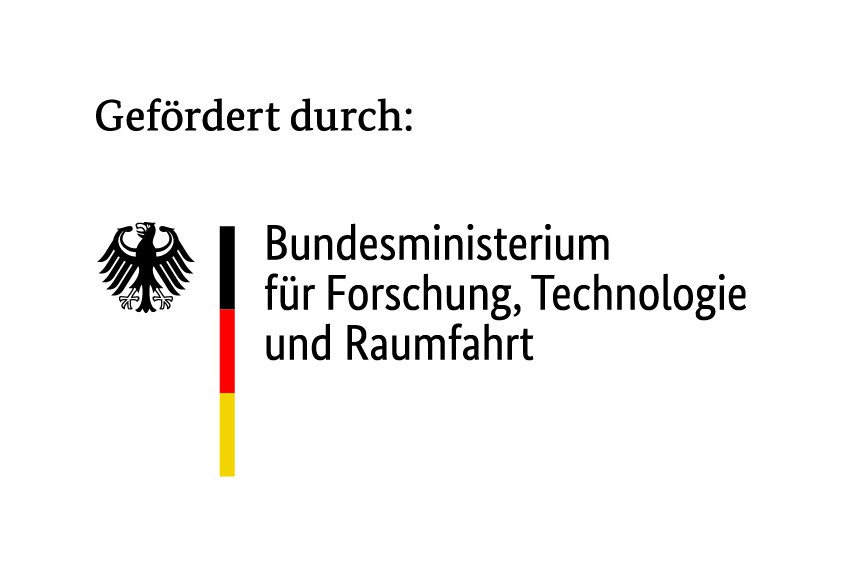

# VBD-MODE_SP4_Projections

  
  

This collaborative hub repository provides near-future projection of vector-borne disease risk for Germany. The proejctions where generated as part of sub project 4 (SP4) of the *Vector-borne disease modelling in Germany -preparing for contemporary and future risk* ([**VBD-MODE**](https://hei-planet.com/vbd-mode/)) conortium project.

VBD-MODE is funded by *Bundesministerium für Forschung, Technologie und Raumfahrt* ([**BMFTR**](https://www.bmftr.bund.de)) and is part of the [**MONID**](https://monid.net/) modelling network.
